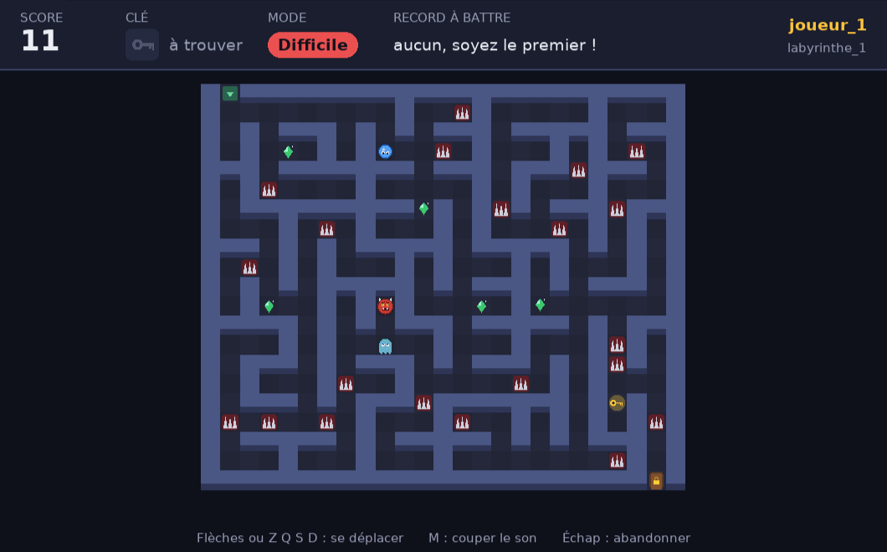
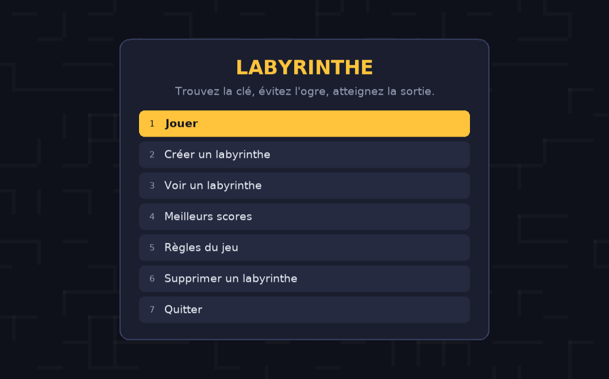
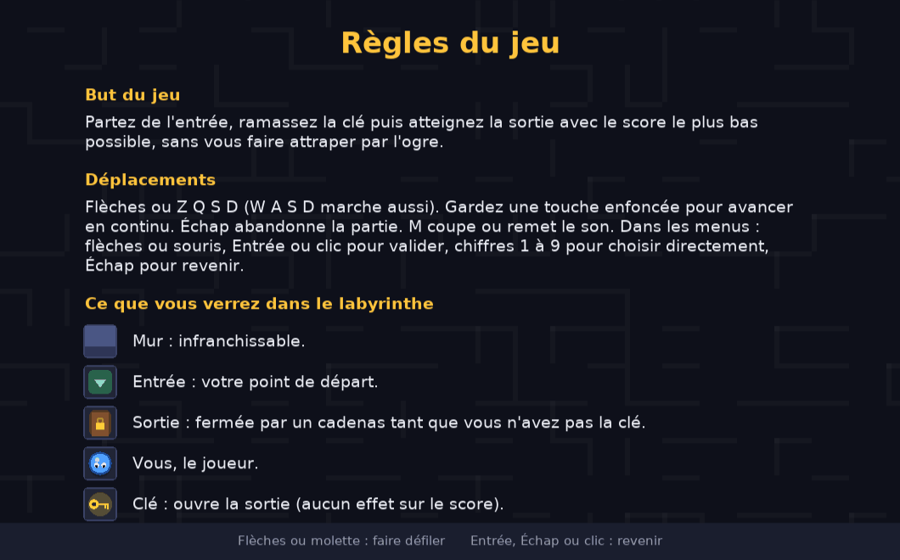
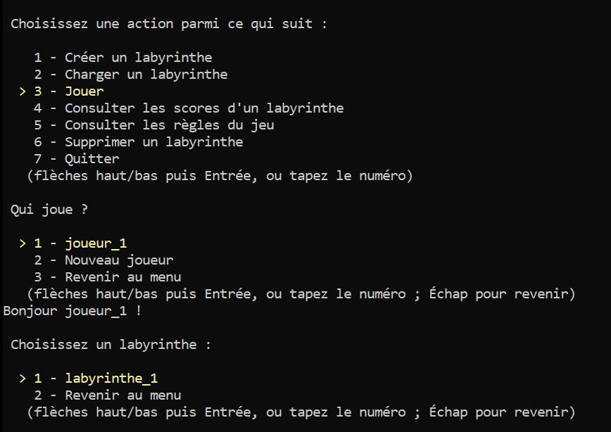

# Labyrinthe

Un jeu de labyrinthe écrit en C : on génère des labyrinthes aléatoires, on y cherche la clé, on évite l'ogre et le fantôme, puis on rejoint la sortie avec le score le plus bas possible. Les scores sont enregistrés par labyrinthe.



## Origine du projet

Ce projet a commencé comme un TP de première année à l'**ENSICAEN**, à la suite du cours de langage C. J'ai ensuite continué à le faire évoluer, jusqu'à la version 2D actuelle.

Le cours m'a beaucoup appris, en particulier :

1. **Les pointeurs et la mémoire dynamique** : allouer avec `malloc` la matrice de cellules qui sert à générer le labyrinthe, la libérer correctement avec `free`, et traquer les fuites avec Valgrind (`make memcheck`).
2. **La programmation modulaire** : séparer le code en modules `.h` / `.c` (labyrinthe, joueur, menu, terminal) et automatiser la compilation séparée avec un `Makefile`.
3. **La manipulation de fichiers** : enregistrer un labyrinthe, son mode et son top 10 dans un fichier texte, puis le relire en vérifiant chaque saisie.
4. **Les tests unitaires** : vérifier chaque module avec des tests automatiques (minunit) avant d'ajouter une fonctionnalité.

## Deux versions du jeu

### Version 2D — branche `master`

La version actuelle se joue dans une fenêtre, avec la bibliothèque **SDL2** :

- menus à la souris ou au clavier ;
- labyrinthe dessiné, déplacements fluides, caméra qui suit le joueur sur les grands labyrinthes ;
- construction animée du labyrinthe à sa création, écran de victoire ou de défaite avec « Rejouer » ;
- effets sonores (pas, clé, piège, bonus, fantôme, ogre, victoire), synthétisés par le programme, sans fichier audio ; la touche **M** coupe le son ;
- une version **Windows** (`.exe`) prête à jouer, sans rien installer.

| Menu principal | Règles du jeu |
|---|---|
|  |  |

### Version terminal — branche [`version-terminal`](https://github.com/mouhssine572/projet_c_labyrinthe/tree/version-terminal)

La version d'origine du TP, entièrement dans le terminal, fonctionne toujours. Elle n'a besoin que de GCC et Make, sans aucune bibliothèque :

- carte en caractères colorés (codes ANSI), redessinée à chaque coup ;
- déplacements sans appuyer sur Entrée (`termios` sous Linux / macOS, `_getch()` sous Windows) ;
- menus parcourus avec les flèches ou en tapant le numéro de l'option.

```bash
git checkout version-terminal
make
./bin/main
```

| Menus | Partie |
|---|---|
|  |  |

La branche `master` contient aussi cette version terminal (`./bin/main`) : la logique du jeu (`labyrinthe.c`, `jouer.c`, `menu.c`) est partagée entre les deux interfaces.

## Jouer sous Windows

1. Téléchargez `Labyrinthe-Windows.zip` depuis la page [Releases](https://github.com/mouhssine572/projet_c_labyrinthe/releases/latest).
2. Décompressez-le (clic droit > « Extraire tout »), puis double-cliquez sur `Labyrinthe.exe`.

Si Windows affiche « Windows a protégé votre ordinateur » (le jeu n'est pas signé), cliquez sur « Informations complémentaires » puis « Exécuter quand même ».

Un labyrinthe (`labyrinthe_1`) et un joueur (`joueur_1`) sont fournis pour tester tout de suite.

## Règles du jeu

Partez de l'entrée, ramassez la **clé**, puis atteignez la **sortie** avec le score le plus bas possible, sans vous faire attraper par l'ogre.

| Élément | Terminal | Effet |
|---|:---:|---|
| Entrée / sortie | `o` / `-` | La sortie reste fermée tant que vous n'avez pas la clé |
| Clé | `$` | Une seule par labyrinthe, ouvre la sortie |
| Piège | `@` | +6 points ; il reste en place et pénalise à chaque passage |
| Bonus | `&` | −6 points (minimum 0) ; il disparaît une fois ramassé |
| Ogre | `G` | Ne traverse pas les murs ; s'il vous attrape, la partie est perdue |
| Fantôme | `F` | Traverse les murs ; s'il vous attrape, votre score est doublé |

Chaque déplacement coûte 1 point. Le mode est choisi à la création du labyrinthe :

| Mode | Ogre | Fantôme | Pièges | Bonus |
|---|---|---|---|---|
| **Facile** | non | non | 2 % des cases | 2 % |
| **Normal** | erre au hasard | non | 3 % | 1,5 % |
| **Difficile** | chasse le joueur (plus court chemin) à moins de 10 cases | oui | 4 % | 1 % |

Le top 10 de chaque labyrinthe est enregistré. À la fin d'une partie gagnée, le jeu affiche votre place et annonce un éventuel nouveau record.

### Commandes

| Touche | Action |
|---|---|
| Flèches ou `Z` `Q` `S` `D` | Se déplacer (touche maintenue : avance en continu dans la version 2D) |
| `M` | Couper / remettre le son (version 2D) |
| Échap | Abandonner la partie, revenir au menu |
| Flèches, souris, `1`–`9` | Choisir dans les menus, Entrée ou clic pour valider |

## Compilation

### Prérequis (Ubuntu / WSL)

```bash
sudo apt install build-essential                                   # GCC et Make
sudo apt install libsdl2-dev libsdl2-ttf-dev libsdl2-mixer-dev     # version 2D
sudo apt install valgrind                                          # facultatif, pour make memcheck
```

### Commandes

```bash
make              # version 2D (bin/labyrinthe) et version terminal (bin/main)
make jeu          # seulement la version 2D
make console      # seulement la version terminal, sans SDL2
./bin/labyrinthe  # lancer la version 2D
./bin/main        # lancer la version terminal

make test         # compiler et lancer les tests unitaires
make memcheck     # les mêmes tests sous Valgrind
make clean        # supprimer les fichiers objets
make distclean    # supprimer aussi les exécutables
BUILD=debug make  # compiler avec les symboles de débogage
```

Sous WSL avec Windows 11, la fenêtre du jeu s'ouvre directement sous Windows (WSLg).

### Version Windows

```bash
sudo apt install gcc-mingw-w64-x86-64 zip   # une seule fois
make windows
```

Le jeu est compilé pour Windows depuis Linux avec MinGW. Les bibliothèques SDL2 pour Windows sont téléchargées automatiquement la première fois (`outils/sdl_windows.sh`). Le résultat, `bin/Labyrinthe-Windows.zip`, contient `Labyrinthe.exe`, les DLL de SDL2, la police, le labyrinthe et le joueur de départ, et un `LISEZMOI.txt`.

## Tests

Trois suites de tests unitaires (framework **minunit**), lancées par `make test` :

- `test_labyrinthe.c` : génération (initialisation, fusion des cellules, labyrinthe complet), sauvegarde et chargement, suppression, placement des motifs selon le mode ;
- `test_jouer.c` : déplacements, clé, pièges et bonus, ogre chasseur, fantôme, classement des scores ;
- `test_menu.c` : validation des noms, chemins des labyrinthes, détection d'un labyrinthe existant.

## Structure du projet

```
projet_c_labyrinthe/
├── Makefile
├── include/              # en-têtes : labyrinthe.h, jouer.h, menu.h, sons.h, terminal.h, minunit.h
├── src/
│   ├── labyrinthe.c      # génération, sauvegarde et chargement des labyrinthes
│   ├── jouer.c           # déplacements, motifs, ogre et fantôme, scores
│   ├── menu.c            # menus, noms des joueurs et des labyrinthes
│   ├── terminal.c        # saisie sans Entrée et couleurs (Windows / Linux / macOS)
│   ├── main.c            # version terminal
│   ├── graphique.c       # version 2D : fenêtre, dessin, menus à la souris (SDL2)
│   ├── sons.c            # effets sonores synthétisés (SDL2_mixer)
│   └── tests/            # tests unitaires
├── outils/               # script de téléchargement de SDL2 pour Windows, fichiers livrés avec le .exe
├── docs/captures/        # captures d'écran du README
├── labyrinthe/           # labyrinthes enregistrés (labyrinthe_1 est fourni)
└── joueurs.txt           # noms des joueurs connus
```

## Détails techniques

- **Génération** : la grille part de cellules toutes isolées par des murs ; on casse des murs au hasard en fusionnant les groupes de cellules, jusqu'à ce que toutes soient reliées. Le labyrinthe obtenu est parfait : un seul chemin entre deux cases.
- **Dimensions** : hauteur et largeur impaires, entre 3 et 201.
- **Fichier d'un labyrinthe** : la première ligne contient `hauteur largeur mode` (1 = Facile, 2 = Difficile, 3 = Normal), puis la grille, puis le top 10 (`score nom`).
- **Noms** : lettres sans accent, chiffres, `_` et `-` uniquement, pour les joueurs comme pour les labyrinthes.

## Auteur

Mouhssine Bairoune — élève ingénieur à l'ENSICAEN.

Bibliothèques SDL2, SDL2_ttf et SDL2_mixer (licence zlib) ; police DejaVu Sans livrée avec la version Windows.
