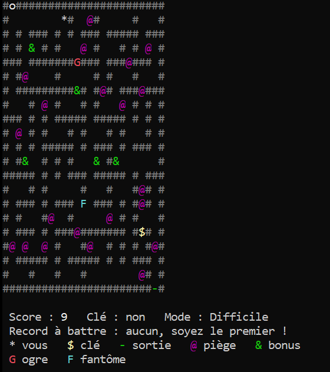
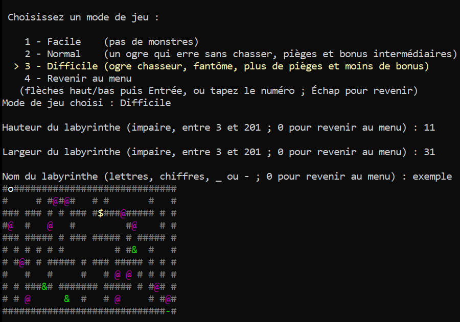

# Labyrinthe — version terminal

Un jeu de labyrinthe écrit en C, qui se joue entièrement dans le terminal : on génère des labyrinthes aléatoires, on y cherche la clé, on évite l'ogre et le fantôme, puis on rejoint la sortie avec le score le plus bas possible. Les scores sont enregistrés par labyrinthe.



> Cette branche contient la **version terminal**, celle du TP d'origine. Une version avec une fenêtre graphique en 2D, des sons et un `.exe` pour Windows se trouve sur la branche [`master`](https://github.com/mouhssine572/projet_c_labyrinthe).

## Origine du projet

Ce projet a commencé comme un TP de première année à l'**ENSICAEN**, à la suite du cours de langage C.

Le cours m'a beaucoup appris, en particulier :

1. **Les pointeurs et la mémoire dynamique** : allouer avec `malloc` la matrice de cellules qui sert à générer le labyrinthe, la libérer correctement avec `free`, et traquer les fuites avec Valgrind (`make memcheck`).
2. **La programmation modulaire** : séparer le code en modules `.h` / `.c` (labyrinthe, joueur, menu, terminal) et automatiser la compilation séparée avec un `Makefile`.
3. **La manipulation de fichiers** : enregistrer un labyrinthe, son mode et son top 10 dans un fichier texte, puis le relire en vérifiant chaque saisie.
4. **Les tests unitaires** : vérifier chaque module avec des tests automatiques (minunit) avant d'ajouter une fonctionnalité.

## Démarrage rapide

Il suffit de GCC et Make, sans aucune bibliothèque à installer (sous Ubuntu / WSL : `sudo apt install build-essential`).

```bash
git clone -b version-terminal https://github.com/mouhssine572/projet_c_labyrinthe.git
cd projet_c_labyrinthe
make
./bin/main
```

Un labyrinthe (`labyrinthe_1`, en mode Difficile) et un joueur (`joueur_1`) sont fournis pour tester tout de suite : choisissez **3 - Jouer**, puis validez deux fois avec Entrée.

## Le jeu en images

| Menus | Création d'un labyrinthe |
|---|---|
|  |  |

- **Menus** : on les parcourt avec les flèches puis Entrée, ou en tapant directement le numéro de l'option. Échap revient au menu principal.
- **Création** : on choisit le mode, la hauteur, la largeur et le nom ; le labyrinthe est généré, affiché puis enregistré.
- **Partie** : la carte est redessinée à chaque coup, en couleur, avec le score, la clé, le mode et le record à battre en dessous. Le joueur bouge dès que la touche est pressée, sans appuyer sur Entrée.

## Règles du jeu

Partez de l'entrée, ramassez la **clé**, puis atteignez la **sortie** avec le score le plus bas possible, sans vous faire attraper par l'ogre.

| Caractère | Signification |
|:---:|---|
| `#` | Mur, infranchissable |
| `o` | Entrée, votre point de départ |
| `-` | Sortie, fermée tant que vous n'avez pas la clé |
| `*` | Vous, le joueur |
| `$` | Clé, une seule par labyrinthe |
| `@` | Piège : +6 points ; il reste en place et pique à chaque passage |
| `&` | Bonus : −6 points (minimum 0) ; il disparaît une fois ramassé |
| `G` | Ogre : ne traverse pas les murs ; s'il vous attrape, la partie est perdue |
| `F` | Fantôme : traverse les murs ; s'il vous attrape, votre score est doublé et il réapparaît ailleurs |

Chaque déplacement coûte 1 point, même contre un mur ; une touche invalide ne compte pas. Le mode est choisi à la création du labyrinthe :

| Mode | Ogre | Fantôme | Pièges | Bonus |
|---|---|---|---|---|
| **Facile** | non | non | 2 % des cases | 2 % |
| **Normal** | erre au hasard | non | 3 % | 1,5 % |
| **Difficile** | chasse le joueur (plus court chemin) à moins de 10 cases | oui | 4 % | 1 % |

Le top 10 de chaque labyrinthe est enregistré. À la fin d'une partie gagnée, le jeu affiche votre place et annonce un éventuel nouveau record, puis propose de rejouer le même labyrinthe.

### Commandes

| Touche | Action |
|---|---|
| `z` `q` `s` `d` ou flèches | Se déplacer (haut, gauche, bas, droite) |
| `0` ou Échap | Abandonner la partie, revenir au menu |
| Flèches puis Entrée, ou `1`–`9` | Choisir dans les menus |
| `0` | Revenir au menu quand le jeu demande un nom ou un nombre |

### Menu principal

1. **Créer un labyrinthe** : mode, dimensions et nom d'un nouveau labyrinthe
2. **Charger un labyrinthe** : afficher un labyrinthe existant
3. **Jouer** : choisir le joueur (ou en créer un), puis le labyrinthe
4. **Consulter les scores** : le top 10 d'un labyrinthe
5. **Consulter les règles du jeu**
6. **Supprimer un labyrinthe** : avec son top 10, après confirmation
7. **Quitter**

## Compilation et tests

```bash
make              # compiler le jeu (bin/main)
./bin/main        # lancer le jeu

make test         # compiler et lancer les tests unitaires
make memcheck     # les mêmes tests sous Valgrind (sudo apt install valgrind)
make clean        # supprimer les fichiers objets
make distclean    # supprimer aussi les exécutables
BUILD=debug make  # compiler avec les symboles de débogage
```

Trois suites de tests unitaires (framework **minunit**) :

- `test_labyrinthe.c` : génération (initialisation, fusion des cellules, labyrinthe complet), sauvegarde et chargement, suppression, placement des motifs selon le mode ;
- `test_jouer.c` : déplacements, clé, pièges et bonus, ogre chasseur, fantôme, classement des scores ;
- `test_menu.c` : validation des noms, chemins des labyrinthes, détection d'un labyrinthe existant.

## Structure du projet

```
projet_c_labyrinthe/
├── Makefile
├── include/              # en-têtes : labyrinthe.h, jouer.h, menu.h, terminal.h, minunit.h
├── src/
│   ├── main.c            # point d'entrée : menu principal et enchaînement des actions
│   ├── labyrinthe.c      # génération, sauvegarde et chargement des labyrinthes
│   ├── jouer.c           # déplacements, motifs, ogre et fantôme, scores
│   ├── menu.c            # menus, noms des joueurs et des labyrinthes
│   ├── terminal.c        # saisie sans Entrée, effacement de l'écran, couleurs (Windows / Linux / macOS)
│   └── tests/            # tests unitaires
├── docs/captures/        # captures d'écran du README
├── labyrinthe/           # labyrinthes enregistrés (labyrinthe_1 est fourni)
└── joueurs.txt           # noms des joueurs connus
```

## Détails techniques

- **Génération** : la grille part de cellules toutes isolées par des murs ; on casse des murs au hasard en fusionnant les groupes de cellules, jusqu'à ce que toutes soient reliées. Le labyrinthe obtenu est parfait : un seul chemin entre deux cases.
- **Saisie directe** : les touches sont lues une par une, sans attendre Entrée (`termios` sous Linux / macOS, `_getch()` sous Windows). Si l'entrée n'est pas un terminal (fichier ou tube), les menus demandent simplement le numéro de l'option.
- **Couleurs** : codes ANSI ; il faut un terminal compatible (Linux, macOS, Windows 10 ou plus récent).
- **Dimensions** : hauteur et largeur impaires, entre 3 et 201.
- **Fichier d'un labyrinthe** : la première ligne contient `hauteur largeur mode` (1 = Facile, 2 = Difficile, 3 = Normal), puis la grille, puis le top 10 (`score nom`).
- **Noms** : lettres sans accent, chiffres, `_` et `-` uniquement, pour les joueurs comme pour les labyrinthes.

## Auteur

Mouhssine Bairoune — élève ingénieur à l'ENSICAEN.
